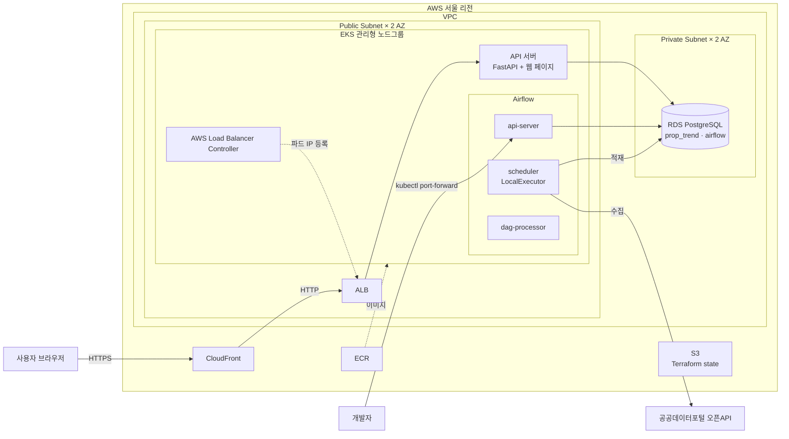

# PropTrend

국토교통부 공공데이터 포털의 부동산 실거래 데이터와 이외에 다양한 연계 데이터를 수집·가공해 부동산 거래에 필요한 유용한 데이터와 지표를 제공하는 서비스.

## 프로젝트 목표

공공데이터로 부동산 실거래 데이터, 부동산 건축물 상세정보, 주변 편의시설 등에 대한 정보를 얻을 수 있지만, 정제되지 않은 원본 데이터는 실제로 유용하게 사용되기 힘듭니다. 프로젝트에서 개발할 PropTrend 서비스는 이러한 원본 데이터들을 수집하고 가공 및 갱신하여 부동산 관련 정보를 쉽게 접할 수 있도록 합니다.

## 프로젝트 시스템

AWS 배포 구성이다. 인프라는 `infra/`의 Terraform이, 앱은 `k8s/`의 매니페스트와 Helm 차트가 만든다.



- 공공데이터포털 오픈API: 법정동코드와 부동산 실거래 원본 데이터를 제공하는 외부 API
- CloudFront: 도메인 없이 HTTPS를 제공하는 진입점. 세션 쿠키가 Secure라 HTTPS가 필요하다
- ALB: CloudFront에서 온 요청만 받아 API 서버 파드로 넘기는 로드밸런서
- EKS: API 서버와 Airflow를 컨테이너로 실행하는 쿠버네티스 클러스터
  - API 서버: 실거래 조회, 대시보드 지표, 회원·즐겨찾기 API와 사용자 웹 페이지를 함께 제공하는 서버
  - Airflow: 오픈API 데이터를 매일 수집·정제·적재하고 시장 지표를 계산하는 파이프라인. UI는 외부에 열지 않고 port-forward로만 접속한다
  - AWS Load Balancer Controller: API 서버 파드 IP를 ALB 타깃그룹에 등록하는 컨트롤러
- RDS PostgreSQL: 서비스 데이터(prop_trend)와 Airflow 메타데이터(airflow)를 저장하는 데이터베이스. 외부에서 닿지 않는 Private Subnet에 둔다
- Public Subnet: 노드가 NAT Gateway 없이 공인 IP로 오픈API와 ECR에 나가도록 노드와 ALB를 두는 서브넷
- ECR: API 서버와 Airflow 컨테이너 이미지 저장소
- S3: Terraform state 저장소

로컬에서는 같은 구성을 Docker Compose 또는 kind(`k8s/kind.sh`)로 띄운다. 이때 DB는 컨테이너 PostgreSQL이다.

## 핵심 기능

- 단지별 부동산 매매/전월세 실거래가 검색
  - 필터 기반 검색
  - 단지 상세 정보 (해당 단지 실거래가 추세)
- 부동산 거래 관련 대시보드
  - 최고가 거래, 최저가 거래, 거래건수
  - 거래액 급등/급락 단지 TOP 5
  - 거래량 급등 지역 TOP 5
- 사용자 즐겨찾기 단지 신규 실거래가 알림
- 사용자 행동 로그 수집 시스템 및 홈 대시보드 위젯 재순위화

## 실행

Docker Compose로 PostgreSQL과 API 서버를 띄운다.

```bash
docker compose up -d
```

- API 서버: <http://localhost:8000>
- PostgreSQL: `localhost:5432`

### kind 클러스터

kind로 컨트롤 플레인 1개, 워커 1개짜리 로컬 쿠버네티스 클러스터를 띄운다. 설정은 `k8s/kind-config.yaml`에 있다.

```bash
# 실행
kind create cluster --config k8s/kind-config.yaml
kubectl get nodes --context kind-prop-trend

# 종료
kind delete cluster --name prop-trend
```

## 프로젝트 이슈

추가 예정

## 라이선스
